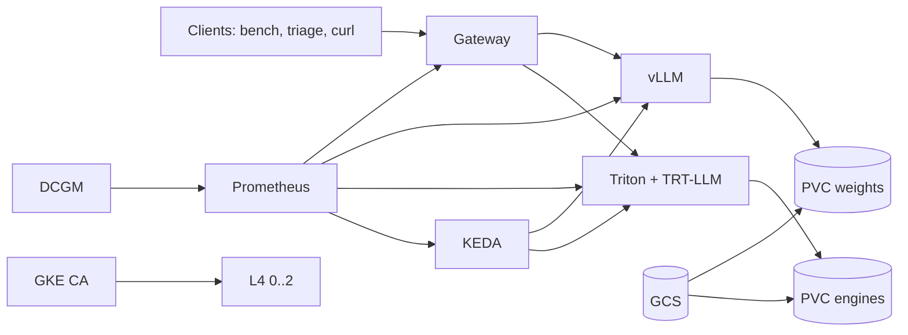

# Infergrid

Cloud-native LLM serving on Kubernetes: one OpenAI-compatible gateway in front
of vLLM and NVIDIA Triton + TensorRT-LLM, autoscaled on queue depth, with a
reproducible benchmark on a single NVIDIA L4.

This repo contains the **code the spec asked for**. Gateway, mock, charts,
model-prep, Triton repo templates, bench runner, triage client, CI, and tests
are here. GPU numbers, GKE, and Kind were **not run** on the author laptop
(Kind's control-plane pinned ~2 CPU cores; [ADR 0006](docs/decisions/0006-no-kind-on-thin-laptops.md)).

**Headline finding:** _not measured._ The results table stays empty until
Phase 8 runs on an L4. Do not invent cells.

## Laptop (no Docker)

```powershell
python -m venv .venv
.\.venv\Scripts\Activate.ps1
pip install -e ".[dev]"
pytest -q
python scripts/dev_up.py
```

```powershell
curl http://127.0.0.1:8080/v1/chat/completions `
  -H "content-type: application/json" `
  -d '{"model":"mock-qwen","messages":[{"role":"user","content":"hello"}],"max_tokens":8}'

python -m clients.triage.assistant "I was charged twice" --model mock-qwen
```

`dev_up.py` starts mock `:8000` + gateway `:8080` using
`gateway/routes.local.yaml`. Completions are synthetic.

## Architecture

See [docs/architecture.md](docs/architecture.md). Clients hit the gateway;
it routes by `model` / `x-backend` to vLLM or Triton. Locally both are the
mock (OpenAI chat plus Triton `generate[_stream]`).



## Spec coverage

| Spec item | Where | Tests | Run here? |
| --- | --- | --- | --- |
| OpenAI `/v1/chat/completions` + stream | `gateway/` | `gateway/tests` | Yes (`make dev`) |
| `/v1/models`, `/healthz`, `/readyz`, `/metrics` | `gateway/app/main.py` | `test_api.py` | Yes |
| Weighted alias + `x-backend` | `gateway/app/routing.py` | `test_routing.py` | Yes |
| Connect-only retry, SSE pass-through | `gateway/app/proxy.py` | `test_api.py` | Yes |
| Triton generate adapter | `gateway/app/adapters.py` | `test_adapters.py` | Yes |
| Mock OpenAI + queue metrics | `mock-backend/` | `mock-backend/tests` | Yes |
| Kind (1 node, Prometheus off) | `infra/local/` | CI `integration.yml` | Not on this laptop |
| GKE + L4 pool 0..2 + budget notes | `infra/gke/` | — | Not run |
| HF download + manifest | `model_prep/download.py` | `test_download.py` | Dry-run only |
| INT4 AWQ (llm-compressor) | `model_prep/quantize_awq.py` | `test_quantize.py` | Dry-run only |
| FP8 HF checkpoint | `model_prep/quantize_fp8.py` | `test_quantize.py` | Dry-run only |
| Accuracy (smoke + lm_eval cmd) | `model_prep/eval_accuracy.py` | `test_eval_accuracy.py` | Smoke vs mock |
| TRT-LLM `build_engine.sh` | `model-prep/trtllm/` | — | Needs L4 + NGC |
| inflight_batcher repo + fill_template | `model-prep/trtllm/repo`, `model_prep/trtllm/` | `test_fill_template.py` | Yes (templates) |
| vLLM chart FP16/AWQ/FP8 | `charts/vllm/` | helm lint in CI | Not deployed |
| Triton chart FP16/FP8 | `charts/triton-trtllm/` | helm lint in CI | Not deployed |
| KEDA on queue depth | `charts/autoscaling/` | helm lint in CI | Not deployed |
| Prometheus / DCGM / Grafana JSON | `charts/observability/`, `dashboards/` | — | Not deployed |
| Recording rules + alerts | `charts/observability/recording-rules.yaml` | — | Not deployed |
| AIPerf runner + L4 floors | `bench/` | `bench/tests` | Dry-run only |
| Full matrix 6×4×2 configs | `bench/configs/matrix.py` | `test_aiperf_and_sanity.py` | Generated in tests |
| LangChain triage client | `clients/triage/` | `clients/tests` | HTTP path yes |
| Edge sim (`util=0.3`) | `edge/simulate.py` | `edge/tests` | Yes (prints args) |
| CI / deploy / nightly stubs | `.github/workflows/` | — | Needs GitHub remote |
| ADRs 0001–0008 | `docs/decisions/` | — | Written |
| Pinned versions | `VERSIONS.md` | — | Recorded 2026-10-10 |

The spec's **exit bar** (stranger reproduces the L4 table within 10%) is
**not met**. That needs GKE credits.

## Gateway API

| Endpoint | Behavior |
| --- | --- |
| `POST /v1/chat/completions` | Stream or JSON; route by `model` |
| `GET /v1/models` | Concrete routes + aliases |
| `GET /healthz` | Process liveness |
| `GET /readyz` | ≥1 upstream `/health` |
| `GET /metrics` | Count, latency, errors, overhead |

Routes: `llama-8b-vllm-fp16`, `llama-8b-trtllm-fp8`, alias `llama-8b` (50/50).
Timeouts: connect 5s, read 300s. Retry once on connect only.

## Model artifacts (Phase 2)

Five artifacts, one base checkpoint. Commands are dry-run safe:

```text
python -m model_prep.download --out artifacts/fp16 --dry-run
python -m model_prep.quantize_awq --model-dir artifacts/fp16 --out artifacts/awq --dry-run
python -m model_prep.quantize_fp8 --model-dir artifacts/fp16 --out artifacts/fp8 --dry-run
python model-prep/trtllm/build_engine.sh   # GPU Job, same NGC tag as serve
python -m model_prep.trtllm.fill_template --src model-prep/trtllm/repo \
  --dest artifacts/repo --values model-prep/trtllm/values-fp16.yaml
python -m model_prep.eval_accuracy --base-url http://127.0.0.1:8080 --model mock-qwen
```

Calibration default: 512 rows of `HuggingFaceH4/ultrachat_200k`. Record the
HF revision in each `manifest.json`.

## Benchmarks (Phase 8)

```text
python -m bench.run_bench --config bench/configs/vllm-fp16-c32-chat.yaml
python -m bench.make_table
```

`--execute` runs `aiperf profile` when the binary is on PATH. Without it the
runner writes `status: not_run` plus the exact command. Matrix: vLLM
FP16/AWQ/FP8 and Triton FP16/FP8/AWQ; concurrency 1/8/32/64; chat 512/256 and
RAG 2048/128; 300 requests after 30 warmup; 3 repeats; median.
Sanity: L4 bandwidth floor and Little's law (`bench/sanity.py`).

| Backend | Precision | Concurrency | TTFT p50/p95 (ms) | ITL p50 (ms) | Output tok/s | KV cache capacity (tokens) | Accuracy | $/1M tokens |
| --- | --- | --- | --- | --- | --- | --- | --- | --- |
| vLLM | FP16 | 32 | | | | | | |
| vLLM | AWQ INT4 | 32 | | | | | | |
| vLLM | FP8 | 32 | | | | | | |
| Triton + TRT-LLM | FP16 | 32 | | | | | | |
| Triton + TRT-LLM | FP8 | 32 | | | | | | |

L4 floors (~300 GB/s): FP16 ≳ 53 ms/token at c=1; FP8 ≳ 27; INT4 ≳ 17.

## GKE (spends credits)

Read [infra/gke/budget-notes.md](infra/gke/budget-notes.md) first ($250 budget).

```bash
export PROJECT=your-gcp-project ZONE=us-central1-a
make cluster-up
kubectl apply -f infra/gke/gpu-smoke.yaml
make deploy-vllm CONFIG=fp16
make cluster-down
```

Kind (`make local-up`) is optional, **one node**, Prometheus **off** unless
`SKIP_OBSERVABILITY=0`. Host port for the gateway NodePort is `18080`.

## Repository

```
gateway/  mock-backend/  clients/triage/
charts/{gateway,mock-backend,vllm,triton-trtllm,autoscaling,observability}
infra/{local,gke}  model_prep/  model-prep/trtllm/repo
bench/  dashboards/  edge/  docs/decisions/  .github/workflows/
```

## ADRs

- [0001 Mock backend](docs/decisions/0001-mock-backend-for-local.md)
- [0002 L4 on GKE](docs/decisions/0002-l4-on-gke.md)
- [0003 KEDA queue depth](docs/decisions/0003-keda-queue-depth.md)
- [0004 Custom gateway](docs/decisions/0004-custom-gateway.md)
- [0005 AIPerf](docs/decisions/0005-aiperf-not-genai-perf.md)
- [0006 No Kind on a thin laptop](docs/decisions/0006-no-kind-on-thin-laptops.md)
- [0007 TRT-LLM vs vLLM](docs/decisions/0007-trtllm-harder-than-vllm.md)
- [0008 Gateway API Inference Extension](docs/decisions/0008-gateway-api-inference-extension.md)

[docs/STATUS.md](docs/STATUS.md) · [VERSIONS.md](VERSIONS.md)

## License

Apache-2.0. Model weights keep their own licenses. Never commit `HF_TOKEN`
or GCP keys.
